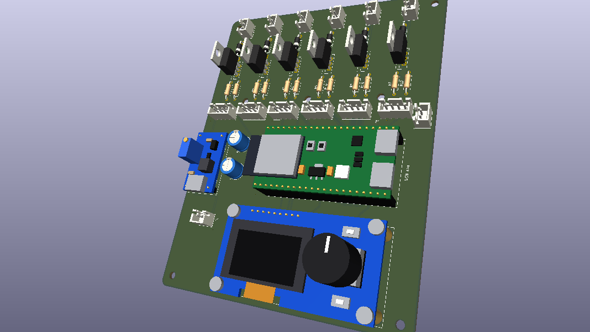

# Plant Watering System

[](LICENSE)
[]()

An automated 6-plant watering system built on an ESP32-S3 (YD-ESP32-23), designed around the failures of typical DIY irrigation projects: corroding sensors, constant over-watering, no verification that watering worked.

- **6 independent stations:** capacitive moisture sensor + 12 V peristaltic pump each
- **Two-phase watering cycle:** dry cycle (check every N hours, water only at the minimum threshold) then incremental watering with soak time until the target is reached
- **Failsafes:** a plant is stopped and flagged if moisture does not rise after a dose, if the sensor reads shorted/disconnected, or if a float switch reports a low reservoir; one pump runs at a time
- **Sensor longevity:** sensors are only powered (DIS pin) for the ~1 s of each reading
- **Local UI:** 128×64 OLED + rotary encoder + Confirm/Back buttons; all settings persist in flash (NVS)



Firmware and tests are PlatformIO/Arduino; the board is designed in KiCad. Plants start **disabled** on a fresh board: enable each one from the menu after calibrating its sensor and pump.

## Quick start

```bash
pip install platformio            # or use the PlatformIO VS Code extension
# Plug into the board's UART USB-C connector (not the one labelled USB),
# then set upload_port in platformio.ini (e.g. COM3).
pio run -t upload                 # build + flash
pio device monitor                # serial log @ 115200
pio test -e native                # watering-logic tests on your computer (needs gcc/clang)
pio test -e yd_esp32_23           # same tests on the board
```

First-time setup from the OLED menu: **Menu → Plant n → Cal sensor** (air, then water), **Cal pump** (run 30 s into a cup, enter the mL), set Target / Min / Water mL / Soak / Check h, then switch **Enabled** on.

## Repository layout

```
platformio.ini            Board/env config (yd_esp32_23 = firmware, native = host tests)
partitions/               16 MB partition table (do not edit)
src/main.cpp              Hardware glue: sensors, pumps, float switch, OLED menu, NVS config
include/pins.h            Pin map (mirrors the schematic)
lib/PlantLogic/           Hardware-free per-plant state machine + helpers (unit-tested)
lib/RotaryEncoder/        Quadrature encoder driver
test/test_plant_logic/    Unity tests for lib/PlantLogic
hardware/
  BOM.md                  Bill of materials, derived from the schematic
  kicad/                  plant_watering.kicad_{sch,pcb,pro} + project symbol/footprint libs
docs/
  WATERING_LOGIC.md       The two-phase algorithm with worked examples
  lessons_learned.md      Research from 50+ failed DIY projects
  archive/                Superseded Arduino UNO R4 POC / single-plant monitor docs
```

## Pin map

| Function | GPIO |
|----------|------|
| Sensors S1–S6 (ADC1) | 1, 2, 7, 8, 9, 10 |
| Sensor DIS (shared, LOW = on) | 11 |
| Pumps 1–6 (MOSFET gates) | 15, 17, 39, 12, 16, 18 |
| Float switch (optional, LOW = reservoir low) | 47 |
| OLED SDA / SCL | 14 / 13 |
| Encoder A / B / push | 5 / 4 / 6 |
| Confirm / Back | 21 / 38 |

Sensors are on ADC1 because ADC2 cannot be used while WiFi is active. Avoid IO0, 3, 45, 46 (strapping), 19/20 (USB) and 35–37 (octal PSRAM).

## Hardware

See [hardware/BOM.md](hardware/BOM.md). Power is a single 5 V / 2 A USB-C charger; an on-board MT3608 boost module makes 12 V for the pumps. Open `hardware/kicad/plant_watering.kicad_pro` in KiCad 10.

## Common DIY mistakes this avoids

| Mistake | Solution here |
|---------|---------------|
| Resistive sensors corrode in weeks | Capacitive sensors, waterproofed with nail polish |
| Sensors always powered | DIS pin: on only while reading |
| Constant watering, root rot | Dry cycle with configurable thresholds |
| Re-watering before moisture spreads | Soak time between doses |
| No check that watering worked | Fault latched if moisture does not rise |
| Pump left running / reservoir empty | Hard 2 min cap per run, float switch stops pumping |

Details: [docs/lessons_learned.md](docs/lessons_learned.md), [docs/WATERING_LOGIC.md](docs/WATERING_LOGIC.md).

## Tuning and best practices

**Soak time** (wait after each dose before re-measuring): sandy/fast-draining soil 3–5 min, loam 5–10 min, clay/slow-draining 10–15 min. Default 5 min.

**Sensors:** capacitive only (resistive ones corrode in weeks), waterproofed with nail polish; calibrate in the real soil, not just air/water; use a TLC555-based sensor on 3.3 V systems, not NE555.

**Mechanical:** keep the reservoir **below** plant level (above it, water keeps siphoning after the pump stops); opaque tubing, 5–6 mm ID (narrower clogs); a closed-end hose with ~1 mm holes at each plant distributes more evenly than Y-splitters; flush with plain water and descale with vinegar when it clogs.

**Maintenance schedule**

| Interval | Task |
|----------|------|
| Weekly | Check reservoir level, test a pump manually, look for odd moisture readings or sensor drift |
| Monthly | Inspect tubing for algae/scale, compare readings with a finger test, check connectors for corrosion |
| Quarterly | Inspect sensor waterproofing, recalibrate if drifting, clean reservoir with vinegar, check MOSFETs/diodes |
| Yearly | **Replace peristaltic pump tubing** (it wears out), deep-clean reservoir and tubing, replace corroded sensors, test failsafes (unplugged sensor, empty reservoir) |

Act immediately if: readings disagree with the soil, a pump runs but no water flows, watering becomes erratic, or you see corrosion on a sensor or wire.

**If WiFi is added later:** the ESP32 does not reliably reconnect on its own, so check `WiFi.status()` in `loop()` and call `WiFi.reconnect()`; use a static IP, a 20 MHz router channel and better than −70 dBm signal. Keep sensors on ADC1 (ADC2 is unusable while WiFi is on). For deep sleep, wait ~500 ms after waking before reading RTC memory and use `1000000ULL` for the timer constant.

## Status

Firmware builds and the watering-logic tests pass. The hardware path (ADC readings, OLED menu, pumps) has **not yet been run on a board**. The earlier single-plant Arduino UNO R4 firmware and docs are kept in `docs/archive/` and in git history.

## TODO

### Before ordering the PCB
- [ ] **Verify every footprint against the physical part** (datasheet or calipers), not just the library name:
  - [ ] YD-ESP32-23 (`plant_watering_parts:YD-ESP32-23`): 25.4 mm row spacing is confirmed; check pin order and pad numbering against the vendor P1/P2 headers
  - [ ] MT3608 module HW-183B (`MT3608_module`): hole spacing 23.4 × 12.7 mm and 1.5 mm drills were **estimated from a photo**; measure the real module
  - [ ] USB-C receptacle GCT USB4125 (6P, horizontal): confirm it is the part you will actually buy and that the board edge placement fits
  - [ ] JST-XH headers (B2B / B4B / B9B-XH-A): pads were shrunk to 1.7 mm round to keep old tracks clear; check against the JST drawing (pitch 2.5 mm, drill, keying side)
  - [ ] IRLZ44N TO-220 (pin order G-D-S), 1N5819 DO-41 (10.16 mm pitch, cathode band), electrolytics D8 mm / P3.5 mm (polarity), 1/4 W resistors (10.16 mm pitch)
  - [ ] Clear the remaining `lib_footprint_mismatch` / filter warnings in DRC or confirm each is intentional
- [ ] Measure **ESP pin 21** (5 V input): some YD-ESP32-23 units wire it as a second 3V3 output; do not feed 5 V before checking
- [ ] Consider moving the ESP so its antenna overhangs the board edge (needs a full re-route); until then the copper-pour keepout under the antenna is the mitigation
- [ ] Re-run ERC/DRC with KiCad 10 after any change; clear the stale-library ERC warnings
- [ ] Check the 3D model / print the PCB 1:1 on paper and test-fit the ESP, MT3608 and connectors
- [ ] Generate Gerbers/drill files and review them in a viewer before sending to the fab

### Bring-up
- [ ] Set the MT3608 output to **12 V with no pumps connected**, then check the +5 V and +3V3 rails
- [ ] Verify the float switch polarity and wiring (contact closes to GND when the reservoir is low; leave J15 empty if unused)
- [ ] Verify the UI module wiring on J2 (OLED I2C address and driver: SH1106 vs SSD1306, encoder direction, CON/BAK buttons)
- [ ] Flash and run the firmware on the real board for the first time (the OLED menu, ADC reads, pumps and NVS are untested on hardware)
- [ ] Calibrate each sensor (air/water) and each pump (30 s into a cup); the 12-bit ADC defaults (3100 dry / 1500 wet) are only a guess
- [ ] Check ADC noise and linearity at 11 dB attenuation with the shared DIS line; tune `SENSOR_WARMUP_MS` / `SENSOR_SAMPLES` if readings drift
- [ ] Confirm one pump at a time stays within the 5 V / 2 A charger limit (boost converter input current)
- [ ] Run a monitor-only period with pumps disconnected to learn each plant's dry-down rate before enabling watering
- [ ] Test the failsafes on the bench: unplug a sensor, run a pump dry (no moisture rise), trip the float switch mid-run

### Firmware
- [ ] Run `pio test -e native` and `pio test -e yd_esp32_23` with a real compiler/board (only a one-off host build has been run so far)
- [ ] Log history (moisture per plant) to flash or serial for tuning thresholds
- [ ] Persist the timer state across power loss (checks currently restart on boot)
- [ ] WiFi + remote status/alerts (needs explicit reconnect logic, static IP, ADC1-only sensors)
- [ ] Menu extras: factory reset, per-plant names, rename `Enabled` default flow for first-time setup
- [ ] Set `upload_port` in `platformio.ini` for your machine

### Mechanical / docs
- [ ] Enclosure, reservoir (below plant level) and tubing layout; opaque tubing, 5–6 mm ID
- [ ] Waterproof each sensor with 2 coats of clear nail polish before use
- [ ] Write a wiring/assembly guide with photos

## License

[MIT](LICENSE)
